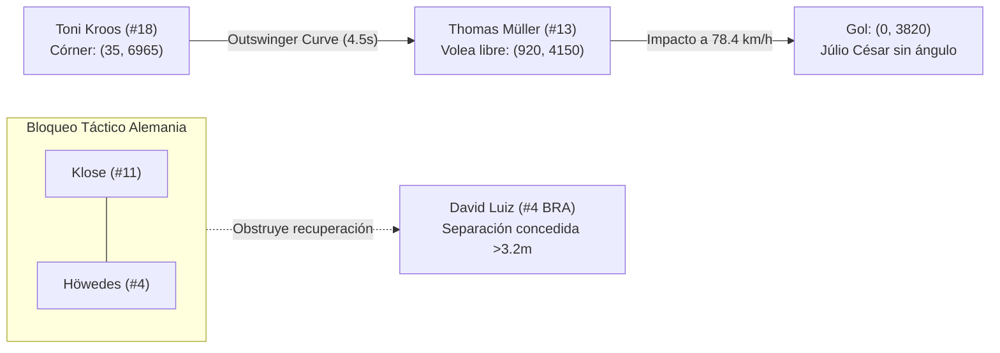

# Sección A: Análisis Específico del 1er Gol de Thomas Müller (Minuto 11')

## Resumen Ejecutivo de la Jugada
- **Partido**: Brasil 1–7 Alemania (Semifinal, Copa Mundial FIFA 2014)
- **Minuto de Partido**: 11' (Reloj de juego oficial: `10:33`)
- **Marcador**: 0–0 $\rightarrow$ 0–1
- **Anotador**: Thomas Müller (#13, GER)
- **Asistente**: Toni Kroos (#18, GER)
- **Tipo de Acción**: Acción a Balón Parado (ABP) — Saque de esquina derecho con efecto hacia afuera (*outswinger*).

---

## 1. Geometría y Parámetros del Terreno de Juego
Bajo el estándar métrico de **Project OMNIMORPH**:
- Dimensiones del campo: $12000\text{ cm} \times 7000\text{ cm}$ ($120\text{ m} \times 70\text{ m}$).
- Portería defendida por Brasil: $x = 0\text{ cm}$, centro de portería en $(0, 3500)$.
- Portería defendida por Alemania: $x = 12000\text{ cm}$.
- Banda Sur: $y = 0\text{ cm}$; Banda Norte: $y = 7000\text{ cm}$.
- Punto de saque de esquina (Kroos #18): $(x: 35\text{ cm}, y: 6965\text{ cm})$.
- Zona de caída / punto de remate (Müller #13): $(x: 920\text{ cm}, y: 4150\text{ cm})$ a $9.2\text{ m}$ de la línea de gol.
- Punto de impacto en la red: $(x: 0\text{ cm}, y: 3820\text{ cm})$.



---

## 2. Desglose en Ventanas Tácticas OMNIMORPH ($\sim 4\text{ s}$ a 25 fps)

### Ventana 1 (`t0: 0.0s`, `t1: 4.0s`, Frames `0`–`100`): Ejecución y Bloqueo Central
- **Estructura Defensiva de Brasil**: Planteamiento mixto vulnerable; concentración masiva pasiva en el área chica (6 futbolistas brasileños) pero marcas individuales descoordinadas en segunda línea.
- **Mecanismo de Bloqueo Alemán**: Miroslav Klose (#11) y Benedikt Höwedes (#4) realizan un movimiento sincronizado de fijación y pantalla ("pick & roll" futbolístico) que bloquea el carril de carrera de David Luiz (#4 BRA) y distrae a Dante (#13 BRA).
- **Trayectoria del Envío**: Kroos sirve un balón abierto con rosca que sobrevuela la primera línea brasileña y busca la zona desprotegida del punto de penal.

### Ventana 2 (`t0: 4.0s`, `t1: 8.0s`, Frames `100`–`200`): Pérdida de Marca, Remate y Gol
- **Ruptura de Marca**: David Luiz pierde de vista a Müller al quedar enganchado tras el tráfico generado por Klose. Müller realiza un desmarque semicircular de retroceso hacia el punto de penalti, logrando una **separación de marca de 3.4 metros** (radio de disparo libre $>3.2\text{ m}$).
- **Definición**: Müller impacta de primera con el empeine interior de la bota derecha en semivolea picada.
- **KPIs OMNIMORPH**:
  - $xG$ de la ocasión: `0.35`
  - Velocidad del remate: `78.4 km/h` (`2177.8 cm/s`)
  - Distancia a portería: `9.2 m` (`920 cm`)
  - Tiempo de reacción del portero Júlio César: `0.41 s` (insuficiente para intervenir).

---

## 3. Archivos del Módulo
1. `gol_1_muller_ventanas.json`: Contrato JSON con las ventanas $\sim 4\text{ s}$, los diagnósticos tácticos para el DT (Mateo Benítez) y la narración auditiva accesible.
2. `muestra_telemetria_muller.json`: Muestra secuencial de telemetría a 25 fps con las coordenadas métricas `pitch_x` y `pitch_y` en cm, velocidades en cm/s y roles dinámicos de los 22 jugadores, árbitro y balón.

---

## 4. Guía de Integración para Roy (Procesador de Video y Dashboard)
Para consumir estos datos en el dashboard de 4 paneles o en el motor de sincronización TTS:
```python
import json

with open("01_gol_muller_min11/gol_1_muller_ventanas.json", "r", encoding="utf-8") as f:
    data_ventanas = json.load(f)

for v in data_ventanas["ventanas_tacticas"]:
    print(f"Ventana [{v['t0']}s - {v['t1']}s]:")
    print(f"  Overlay DT: {v['texto_tactico_dt']}")
    print(f"  Audio TTS: {v['texto_narracion_accesible']}")
    print(f"  Métricas: xG={v['metricas'].get('xg')}, Separación={v['metricas'].get('separacion_marca_radio_m')}m")
```
